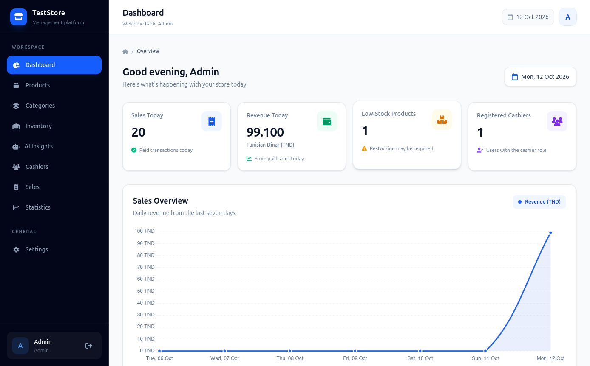
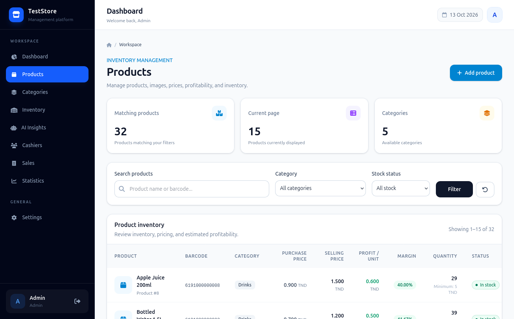
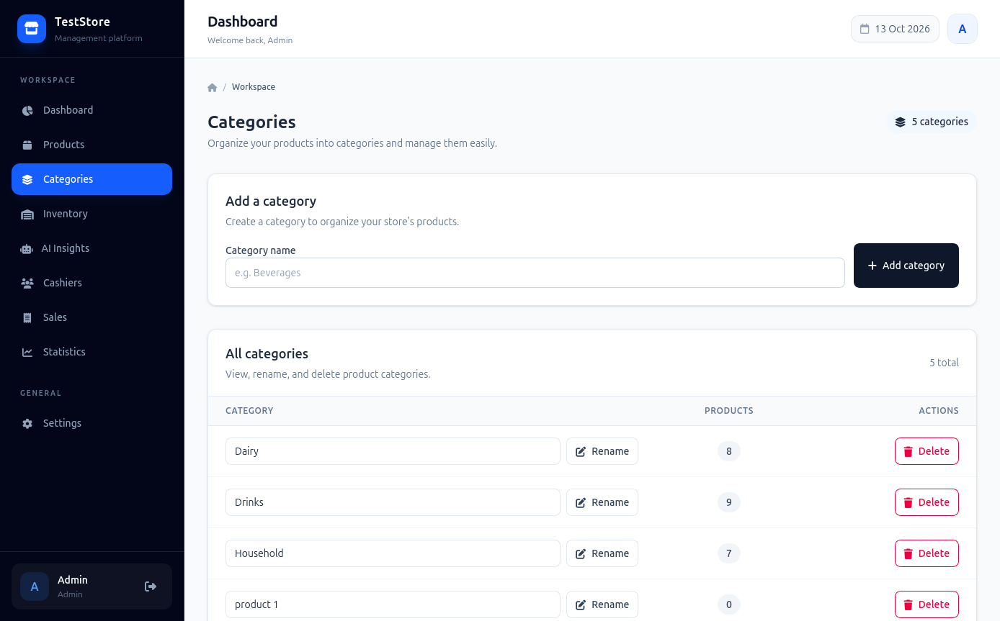
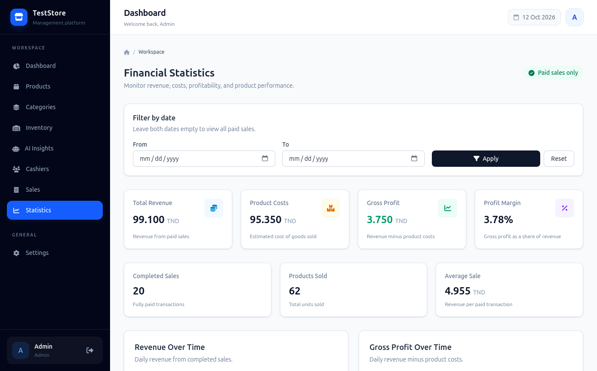
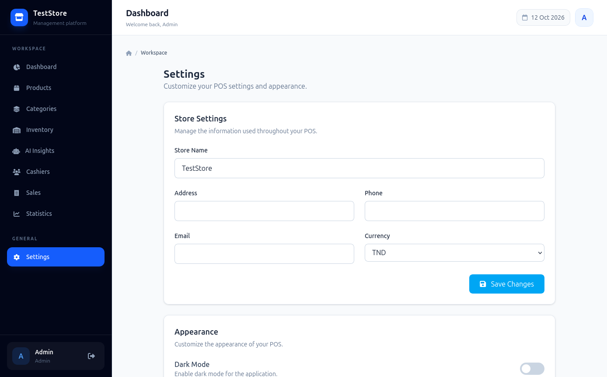
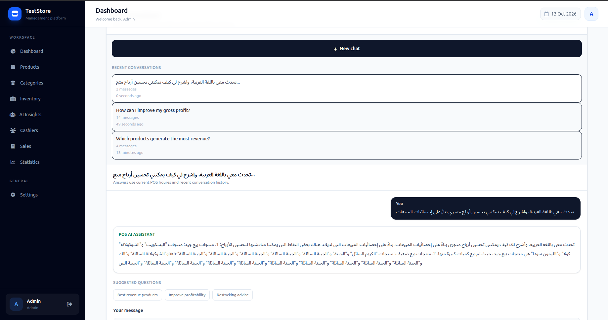
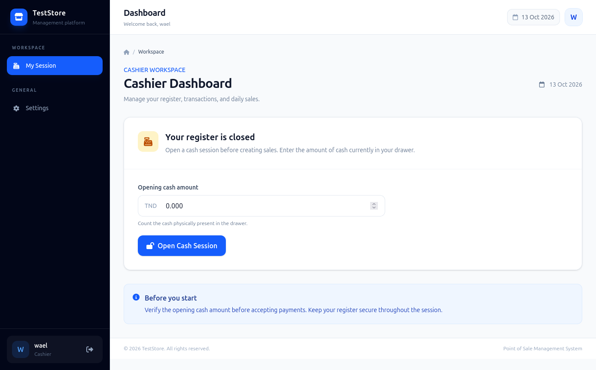
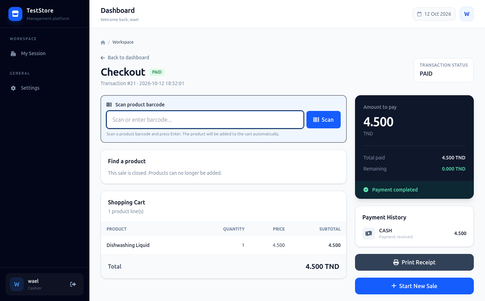

# Laravel POS System

A modern Point of Sale (POS) system built with Laravel to manage products, categories, inventory, sales, payments, receipts, cash sessions, users, and store settings.

The application provides separate interfaces for administrators and cashiers, with role-based access control. It also includes an AI-powered business assistant that analyzes POS statistics and answers questions using local AI through Ollama.

## Screenshots

### Administrator Dashboard



### Product Management



### Product Details


### Category Management



### Statistics and Financial Analysis



### Store Settings



### AI Business Assistant



### Cashier Point of Sale



### Sale Details



## Features

### Authentication and Access Control

- User authentication.
- Role-based access control.
- Separate administrator and cashier roles.
- Protected routes and actions.
- Role-specific dashboards and permissions.

### Product Management

- Create, edit, and delete products.
- Organize products by category.
- Manage product prices and information.
- Associate products with inventory records.
- Access product details.

### Category Management

- Create and manage categories.
- Organize products into categories.
- Update category information.

### Inventory Management

- Monitor available stock quantities.
- Track inventory levels.
- Identify products with low stock.
- Manage product stock information.

### Point of Sale

- Create sales and add products to transactions.
- Calculate sale totals.
- Process payments.
- Calculate change.
- Associate sales with cash sessions.
- Access sale details.

### Receipts

- Generate printable receipts.
- Display store information.
- Display cashier information.
- Show purchased products and quantities.
- Include sale totals and payment information.
- Support the store's configured currency.

### Cash Session Management

- Manage cashier cash sessions.
- Record session opening and closing information.
- Associate sales with cash sessions.
- Track cashier activity.

### Statistics and Financial Analysis

Administrators can access sales and financial statistics, including:

- Total revenue.
- Total sales.
- Products sold.
- Average sale value.
- Estimated costs and gross profit.
- Gross profit margin.
- Best-selling products.
- Low-stock products.
- Sales performance over a selected date range.

Financial calculations depend on the available transaction and purchase-price data. Estimated profit should not be interpreted as net profit because operating expenses and other business costs may not be included.

### AI Business Assistant

The application integrates a local AI assistant powered by Ollama.

Features include:

- Ask questions about sales and business performance.
- Analyze revenue, estimated costs, and gross profit.
- Identify best-selling products.
- Receive recommendations about inventory and restocking.
- Generate explanations of available POS statistics.
- Maintain persistent conversations using the database.
- Ask follow-up questions using recent conversation history.
- Start new conversations without losing previous ones.
- Use a locally running AI model without requiring an external AI API.

The AI assistant uses available POS data to provide business insights. Its recommendations should be reviewed before making important financial or inventory decisions.

### Store Settings

Administrators can configure:

- Store name.
- Store address.
- Phone number.
- Email address.
- Currency.

### Appearance

- Light theme.
- Dark theme.
- Saved theme preferences per user.
- Responsive interface.

## Technologies

| Technology | Purpose |
|---|---|
| PHP | Backend programming language |
| Laravel | Backend framework |
| MySQL | Relational database |
| Eloquent ORM | Database operations and relationships |
| Blade | Server-side templating |
| Tailwind CSS | Interface styling |
| JavaScript | Interactive frontend functionality |
| Ollama | Local AI model runtime |
| Qwen 2.5 3B | AI model used for business assistance |
| Git | Version control |

## Architecture

The application follows the Model-View-Controller (MVC) architecture provided by Laravel.

```text
Laravel POS
|
|-- app/
|   |-- Models/
|   |   |-- User
|   |   |-- Product
|   |   |-- Category
|   |   |-- Stock
|   |   |-- Sale
|   |   |-- SaleItem
|   |   |-- Payment
|   |   |-- CashSession
|   |   |-- Parametre
|   |   |-- AiConversation
|   |   |-- AiMessage
|   |
|   |-- Http/
|       |-- Controllers/
|       |   |-- Admin/
|       |   |-- Cashier/
|       |   |-- Authentication
|       |
|       |-- Middleware/
|
|-- resources/
|   |-- views/
|       |-- admin/
|       |-- cashier/
|       |-- products/
|       |-- categories/
|       |-- sales/
|       |-- statistics/
|       |-- settings/
|
|-- database/
|   |-- migrations/
|   |-- seeders/
|
|-- routes/
|   |-- web.php
|
|-- public/
|
|-- screenshots/
```

The exact organization of views and controllers may vary depending on the implementation.

### AI Conversation Architecture

The AI assistant uses two database models to maintain conversation history.

- `AiConversation`: Stores conversations associated with users.
- `AiMessage`: Stores individual user messages and AI responses.

Each conversation can contain multiple messages. Conversations are associated with their owners so that users cannot access another user's conversations through the conversation routes.

When a question is submitted, the application gathers relevant POS statistics and sends the question, recent conversation history, and business data to the local Ollama API.

## User Roles

### Administrator

Administrators have access to the management side of the application.

They can:

- Manage products and categories.
- Manage stock information.
- Manage cashiers.
- View sales and transaction details.
- Access statistics and financial analysis.
- Configure store settings.
- Manage their appearance preferences.
- Use the AI business assistant.
- Access their saved AI conversations.

### Cashier

Cashiers have access to the sales interface.

They can:

- Manage their cash sessions.
- Create sales.
- Add products to transactions.
- Process payments.
- Print receipts.
- View sale and session information.
- Change their appearance preferences.

Access to administrative functions is restricted according to the application's role-based access rules.

## Installation

### Requirements

Before installing the application, ensure that the following software is available:

- PHP version compatible with the project's `composer.json`.
- Composer.
- MySQL.
- Node.js and npm.
- Git.
- Ollama, if you want to use the AI assistant.

Required PHP extensions depend on the Laravel and Composer dependencies installed by the project.

### 1. Clone the Repository

Replace the repository URL with the actual URL of your GitHub repository.

```bash
git clone https://github.com/YOUR_USERNAME/YOUR_REPOSITORY.git

cd YOUR_REPOSITORY
```

### 2. Install PHP Dependencies

```bash
composer install
```

### 3. Install Frontend Dependencies

```bash
npm install
```

Build the frontend assets:

```bash
npm run build
```

### 4. Configure the Environment

Create the environment configuration file:

```bash
cp .env.example .env
```

Generate the Laravel application key:

```bash
php artisan key:generate
```

### 5. Configure the Database

Create a MySQL database for the application.

For example:

```sql
CREATE DATABASE pos_laravel_project;
```

Update the database configuration in your `.env` file:

```env
DB_CONNECTION=mysql
DB_HOST=127.0.0.1
DB_PORT=3306
DB_DATABASE=pos_laravel_project
DB_USERNAME=your_database_username
DB_PASSWORD=your_database_password
```

Use the credentials and database connection settings appropriate for your environment.

### 6. Run Database Migrations

Run the migrations to create the application's database tables:

```bash
php artisan migrate
```

The migrations include the tables required for the AI conversation history.

If the project contains seeders and you want to populate the database with the configured sample data, run:

```bash
php artisan db:seed
```

Review the seeders before running them against a database containing existing data.

### 7. Configure Ollama

Install Ollama by following the official instructions:

https://ollama.com/download

Download the model used by the application:

```bash
ollama pull qwen2.5:3b
```

Verify that the model is installed:

```bash
ollama list
```

Start the Ollama service if it is not already running. On Linux installations using the system service, you can use:

```bash
sudo systemctl start ollama
```

Check whether the local API is responding:

```bash
curl http://127.0.0.1:11434/api/tags
```

The API should return information about the installed models.

Ensure that the Ollama URL and model name used by the Laravel application match your local configuration.

For the default local setup, the values are:

```text
Ollama URL: http://127.0.0.1:11434
Model: qwen2.5:3b
```

The AI assistant requires Ollama to be running when a request is made. AI response quality and language support depend on the selected model.

### 8. Start the Application

Start the Laravel development server:

```bash
php artisan serve
```

Open the application at:

http://127.0.0.1:8000

You can also use your preferred local development environment, such as Lerd, if it is configured for the project.

### 9. Clear Laravel Caches if Necessary

If configuration or view changes are not reflected in the application, run:

```bash
php artisan optimize:clear
```

## Security

The application uses Laravel features and application-level controls to help protect access to its resources.

These include:

- Authentication.
- Role-based authorization.
- Middleware-protected routes.
- CSRF protection for web forms.
- Server-side request validation.
- User-scoped AI conversation access.

For production deployments, configure secure environment variables, use HTTPS, protect database credentials, and review all authorization rules.

Do not commit the `.env` file, application keys, passwords, or other secrets to the repository.

## Development

Useful commands for local development include:

Clear cached configuration, routes, and views:

```bash
php artisan optimize:clear
```

List registered routes:

```bash
php artisan route:list
```

Run database migrations:

```bash
php artisan migrate
```

Build frontend assets:

```bash
npm run build
```

Check the working tree:

```bash
git status
```

## Project Goals

This project brings together inventory management, sales processing, financial reporting, and locally hosted AI assistance in one application.

The goal is to provide a practical POS system with an administrator interface, a cashier workflow, and AI-assisted analysis of business data.

## License

Choose and add a license appropriate for your project before distributing or reusing the code.

If no license has been added, all rights remain reserved by the copyright holder by default.

## Author

Developed as a Laravel-based Point of Sale project.

